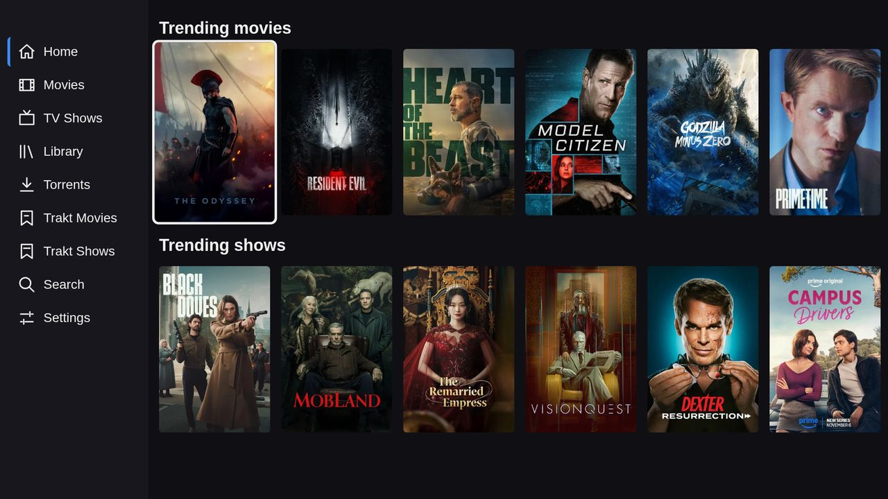
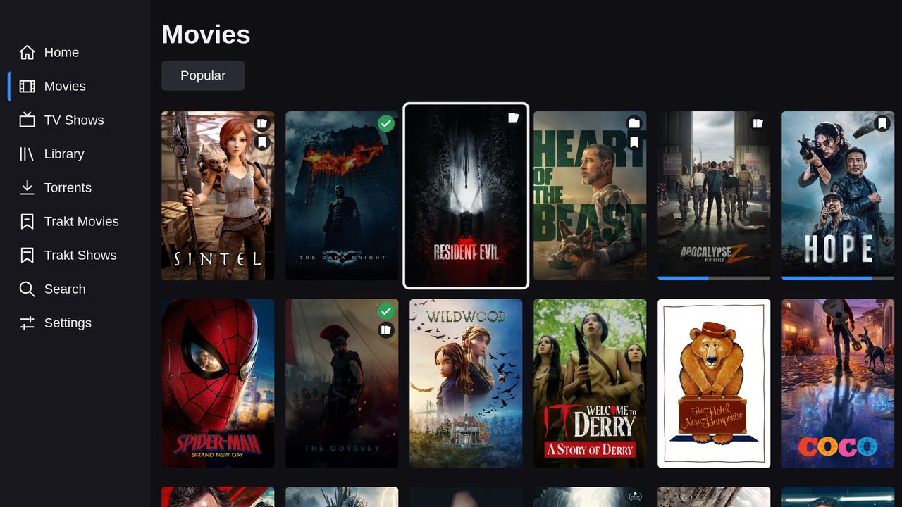
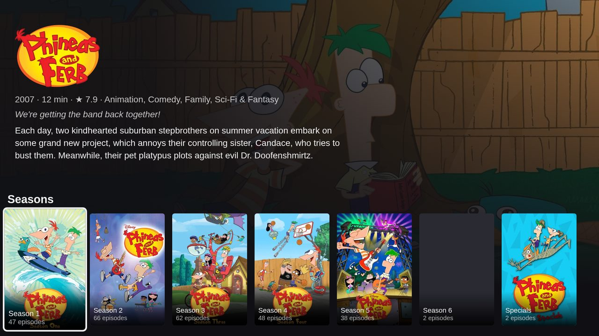
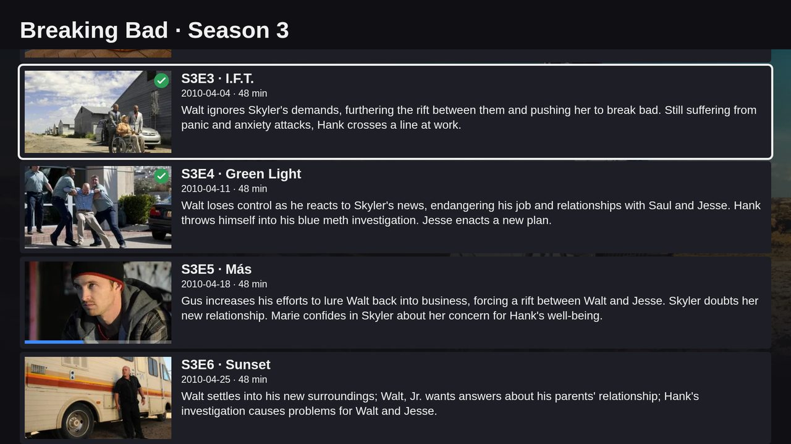
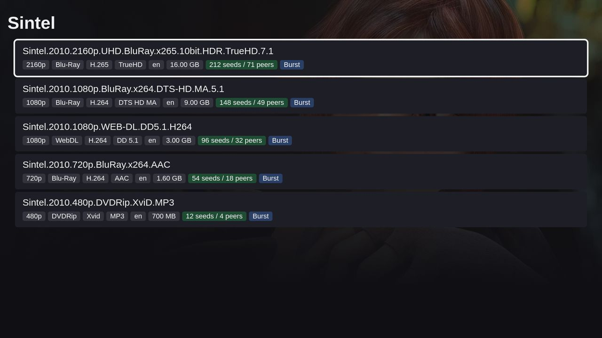
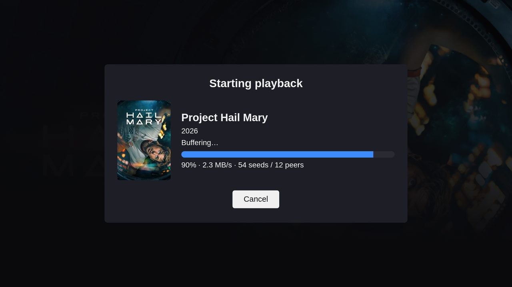
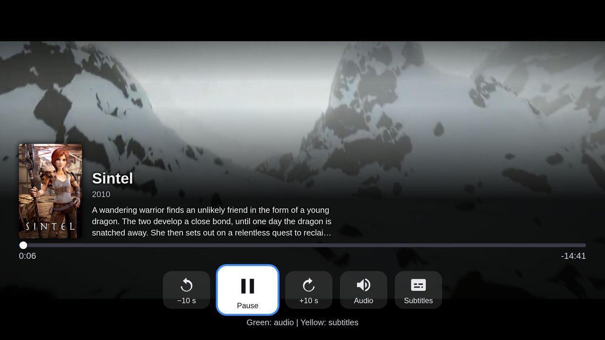
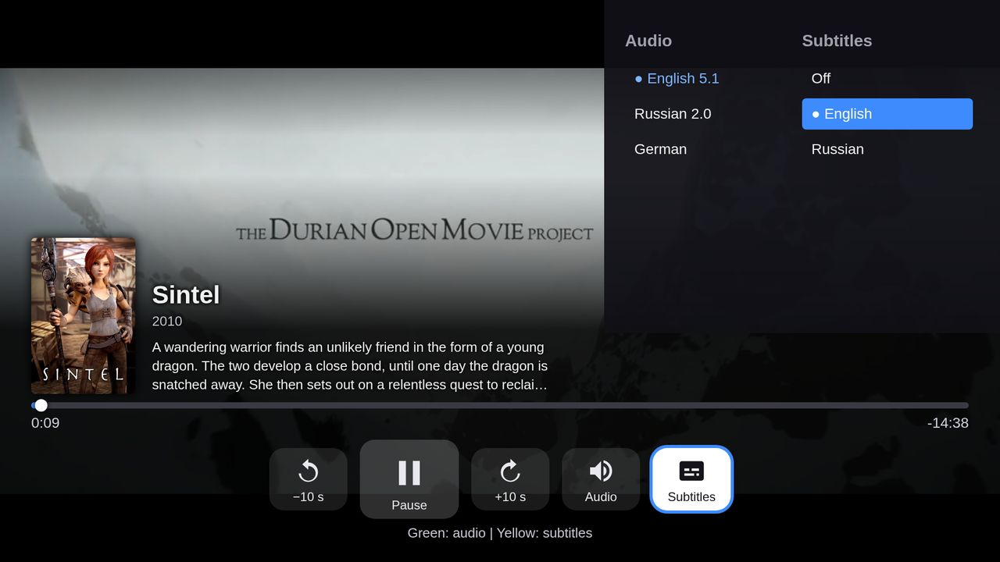
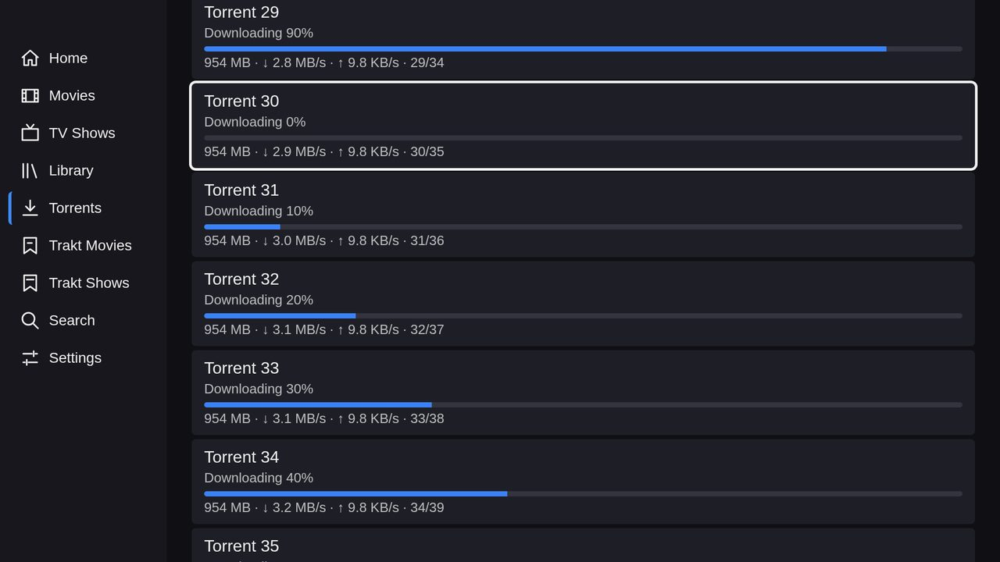
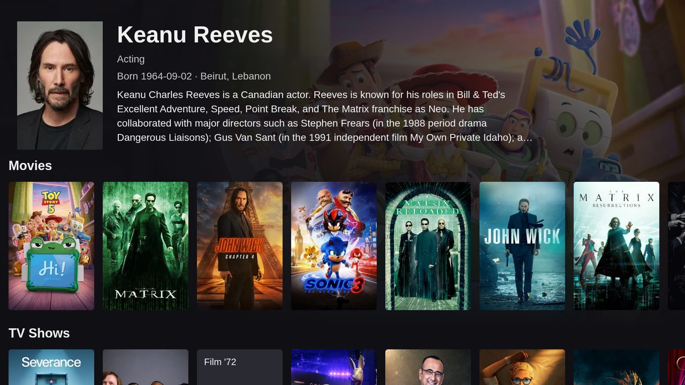

# elementum-tizen

A Samsung Tizen TV app: a remote-controlled front-end for [Elementum](https://github.com/elgatito/elementum)
on your LAN. Browse movies and shows, search, pick a torrent stream and play it on the TV. The TV app talks to Elementum directly;
Elementum still uses Kodi for provider (Burst) search.

| | |
|---|---|
|  |  |
|  |  |
|  |  |
|  |  |
|  |  |

## Requirements

- **Elementum built from the `api` branch** (planned for the plugin.video.elementum 0.1.120 release), i.e.
  Elementum with the `/api/v1` JSON API. A stock release has no such API and the app cannot connect. It must
  run on a machine reachable from the TV on the LAN (default port 65220).
- **Kodi with the Burst add-on** (or another provider add-on) for stream search and for tracker
  authorization (Trakt, Simkl, MDBList, ...).
- A Samsung TV with **Tizen 4.0 or newer** (2018+ models), in **Developer Mode** for sideloading
  (see INSTALL.md).

## Install

See [INSTALL.md](INSTALL.md). The recommended way is **Apps2Samsung**, which signs and installs the `.wgt` from
[GitHub Releases](https://github.com/ElementumOrg/elementum-tizen/releases/latest) for you
(notes in [docs/apps2samsung.md](docs/apps2samsung.md)). The Tizen CLI works too.

## Features

- Home rows (Next up, trending, watchlist) and a Library screen.
- Browse movies and shows (popular, trending and more), search, details, seasons and episodes, with a
  focus on the first unwatched episode.
- Posters carry badges (library, collection, watchlist, watched) and progress bars; watched state is
  shown for movies, episodes and seasons.
- Context menu (long-press OK): add to or remove from the library, mark watched or unwatched.
- Trakt and other tracker lists (movies and shows), shown under the tracker's name.
- Torrents screen: active torrents with progress, speed and peers, and pause, resume and remove.
- Actor pages with their movies and shows.
- Stream list with quality, codec, audio, size, seeds and provider badges.
- Player built on Samsung's AVPlay: seek (±10 s, FF/RW ±60 s), resume, and audio and subtitle switching without pausing
  (Green cycles audio, Yellow cycles subtitles).
- Elementum's own notifications, progress, questions and input prompts appear on the TV.
- Settings for the server (address, port, login) and the language.
- 22 languages, following the TV or chosen in Settings. All but English are machine-drafted
  (see [docs/translations.md](docs/translations.md)).

## Security notes

- Elementum's API allows requests from **any origin** (CORS `*`) on all its routes, and its login is **off by
  default**, so any device or web page on your LAN can use it. Set a login: in Kodi, Elementum settings →
  Addon Startup → Authorization → "Remote host login/password" (the addon settings `remote_login` /
  `remote_password`, which the addon passes to the daemon as `-localLogin` / `-localPassword`). Then enter
  them in the TV app. Without Kodi (settings-file mode) pass those flags yourself; `settings.json` does not
  carry the login.
- The login does not cover `/files/`, Elementum's file server used by Kodi.
- The app stores the Elementum **password in plain text** on the TV.
- Stream links are HMAC-signed and expire, so the player needs no credentials, but do not share them.
- Notifications forwarded to the TV can contain **file paths and error text** from the Elementum host, and
  stream entries can contain host paths or provider URLs with passkeys.
- Run Elementum only on a network you trust; do not expose its port to the internet.

## Development

Requires Node.js 20.19+ or 22.12+.

```sh
npm ci              # install pinned dependencies
npm run dev         # dev server; open the printed URL in Chrome (layout is fixed at 1920x1080)
npm run build       # production build into dist/ (index.html, config.xml, icon.png, assets/)
npm run typecheck   # tsc --noEmit
npm test            # vitest (builds dist/ first; includes the i18n completeness and build tests)
npm run api:sync    # copy apiv1/openapi.yaml from Elementum and regenerate src/api/schema.d.ts
```

`api:sync` reads the spec with `git show $ELEMENTUM_REF:apiv1/openapi.yaml` from the repo at
`$ELEMENTUM_REPO` (defaults: `../elementum`, ref `api`).

**Against a dev daemon:** build and run Elementum from the `api` branch, open the dev server URL in Chrome and
enter the daemon's IP and port (for example `127.0.0.1` and `65220`) on the setup screen. The API's CORS
headers allow the browser to call it directly. Without a TV, playback uses an HTML5 player instead of AVPlay.

### Project structure

```
src/api/       typed API client (schema.d.ts is generated)
src/uiClient.ts  long-poll client for Elementum's UI host (dialogs, toasts, questions)
src/screens/   Home, lists, search, details, seasons, streams, buffering, Torrents, person, settings
src/player/    player (AVPlay and HTML5 behind one interface), OSD, track panel
src/nav/       D-pad focus (spatial navigation), long press, screen stack, key codes
src/ui/        shared components and Elementum UI-host dialogs/toasts
src/i18n/      one JSON per language; en.json is the source
public/        config.xml, icon
scripts/       api:sync, sync-languages
test/          vitest tests
docs/          notes, install helpers, screenshots, translations
```

## How releases are built

`.github/workflows/build.yml` runs typecheck and tests, then packages `dist/` into `Elementum-<version>.wgt`
with the Tizen Studio CLI. Every run uploads the `wgt` and `dist` artifacts. Pushing a tag `v<version>`
(it must equal `package.json`'s version) also creates a GitHub Release with the `.wgt` attached.

Optional repository secrets `TIZEN_AUTHOR_P12_BASE64` (`base64 -w0 author.p12`) and `TIZEN_AUTHOR_PASSWORD` give
release builds a stable Tizen author certificate. They are used on pushes only; pull requests and runs without
them sign with a throwaway certificate. Installers re-sign the package for the TV anyway.

## Translations

All languages except English are machine-drafted and need native-speaker review. Contributions are welcome:
see [docs/translations.md](docs/translations.md).

## Changelog and license

See [CHANGELOG.md](CHANGELOG.md). Licensed under the [MIT license](LICENSE).
