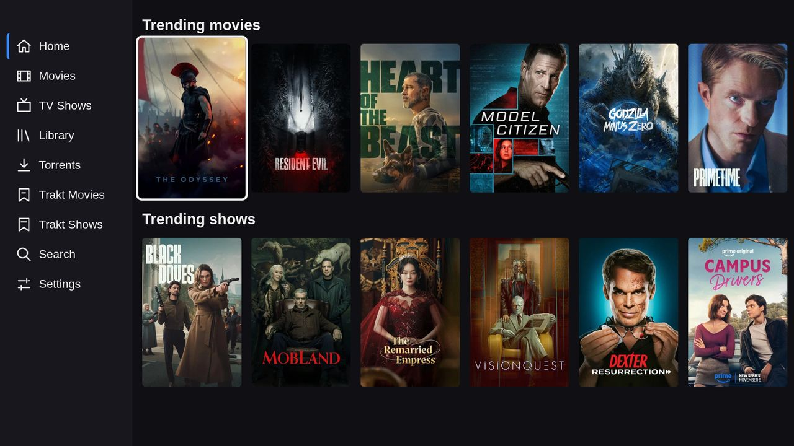
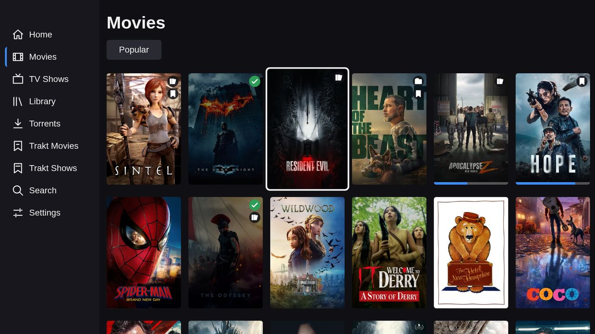
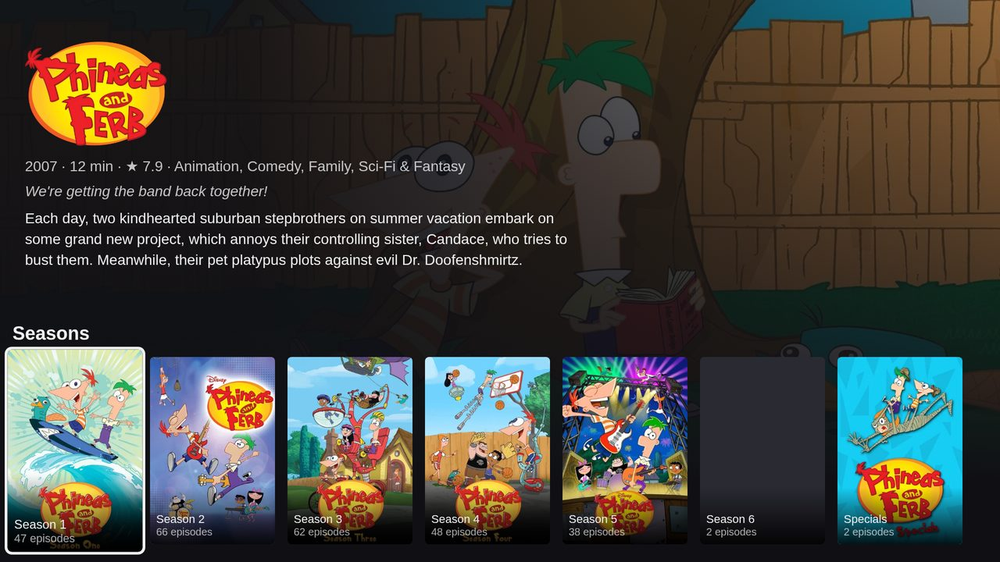
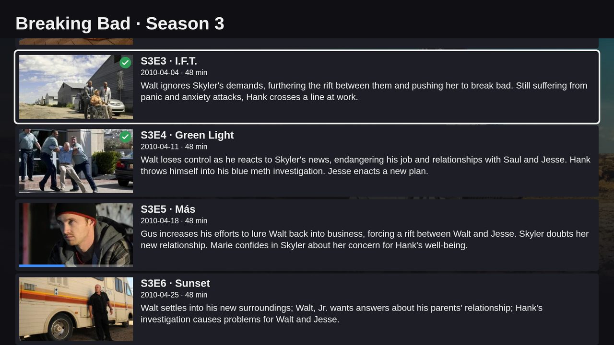
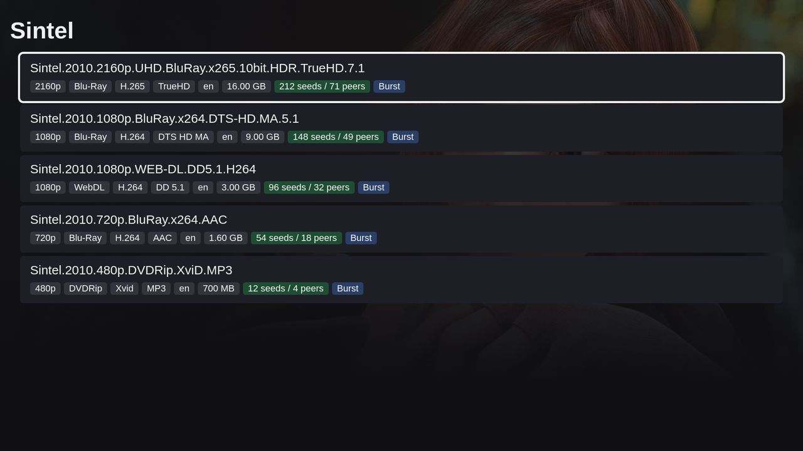
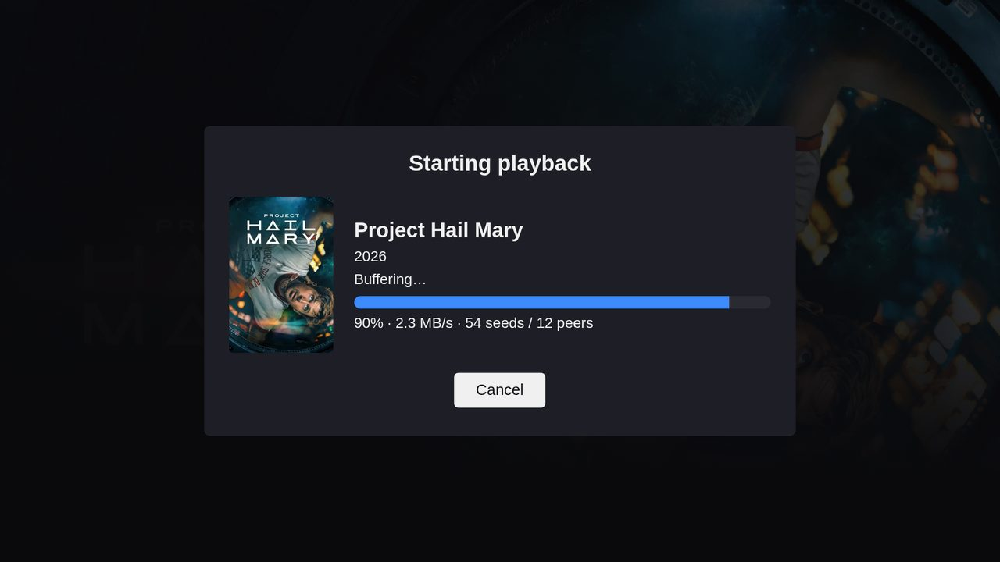
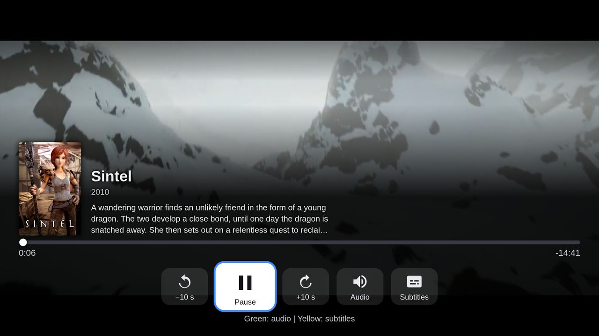
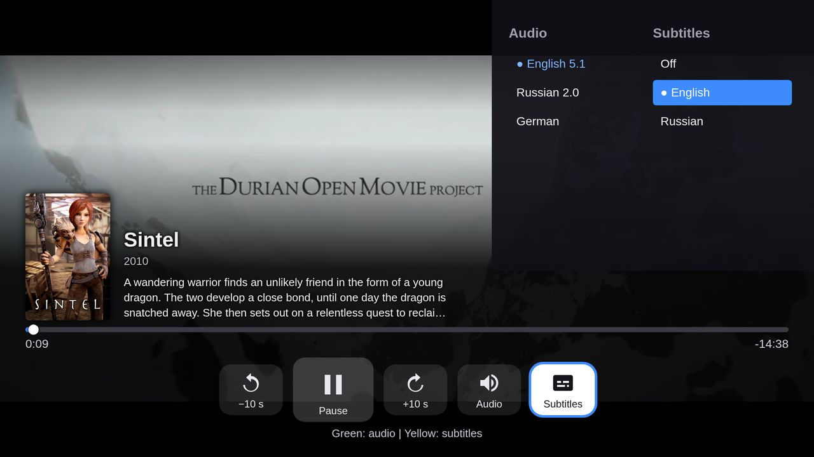
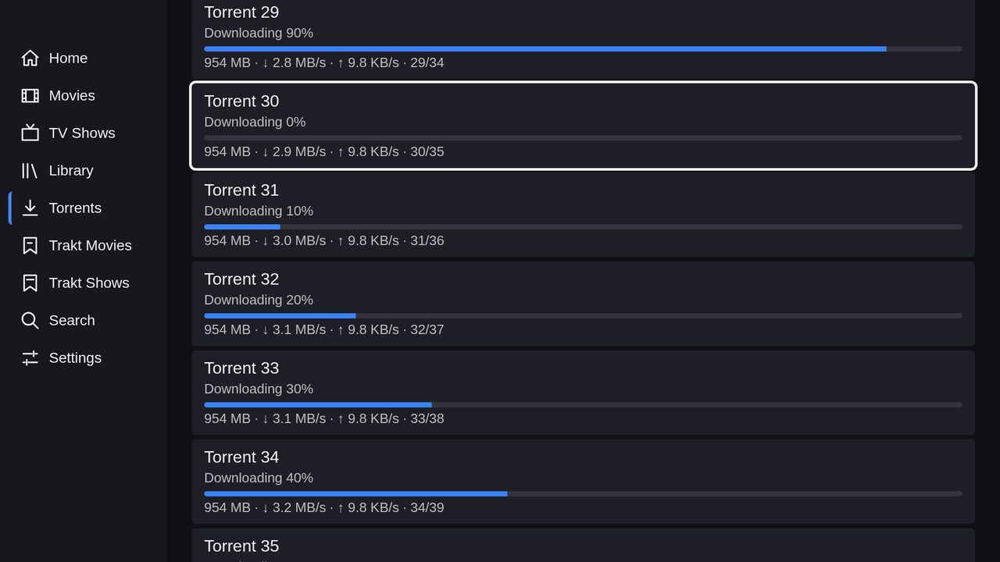
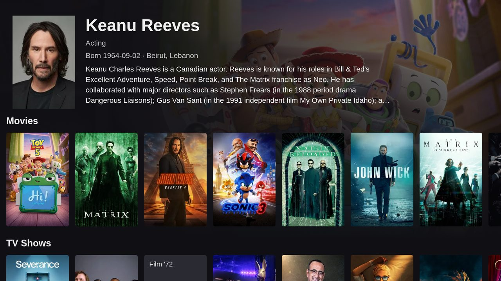

# elementum-tv

A Samsung (Tizen) and LG (webOS) TV app: a remote-controlled front-end for
[Elementum](https://github.com/elgatito/elementum) on your LAN. Browse movies and shows, search, pick a torrent
stream and play it on the TV. The TV app talks to Elementum directly,
and Elementum searches the torrent sites itself (its built-in search), so Kodi is optional.

| | |
|---|---|
|  |  |
|  |  |
|  |  |
|  |  |
|  |  |

## Requirements

- **Elementum 0.1.120 or newer** (until it is released: built from Elementum's `master` branch), which has the
  `/api` JSON API. Older releases have no such API and the app cannot connect. It must run on a machine reachable
  from the TV on the LAN (default port 65220), as the Kodi add-on, on a server or in
  [Docker](https://github.com/ElementumOrg/elementum-docker). Update the daemon and TV app together.
- **Kodi is optional.** Without it Elementum searches with its built-in search, set up from the TV
  (Settings → Built-in search settings). With Kodi, Elementum's "Search torrents with" setting decides between
  the built-in search and Kodi provider add-ons such as Burst.
  Tracker authorization (Trakt, Simkl, MDBList, ...) uses JSON device login and works without Kodi.
- A Samsung TV with **Tizen 4.0 or newer** (2018+ models), in **Developer Mode** for sideloading
  (see INSTALL.md).
- Or an LG TV with **webOS 4.0 or newer** (2018+ models), in Developer Mode or rooted with Homebrew Channel
  (see INSTALL.md). **Experimental: not yet tested on a real TV.**

## Install

See [INSTALL.md](INSTALL.md). The recommended way is **Apps2Samsung**, which signs and installs the `.wgt` from
[GitHub Releases](https://github.com/ElementumOrg/elementum-tv/releases/latest) for you
(notes in [docs/apps2samsung.md](docs/apps2samsung.md)). The Tizen CLI works too.
On LG, install `Elementum-<version>.ipk` from the same release (see [INSTALL.md](INSTALL.md#lg-webos)).

## Features

- Home rows (Next up, trending, watchlist) and a Library screen.
- Browse movies and shows (popular, trending and more), search, details, seasons and episodes, with a
  focus on the first unwatched episode.
- Posters carry badges (library, collection, watchlist, watched) and progress bars; watched state is
  shown for movies, episodes and seasons.
- Context menu (long-press OK): add to or remove from the library, mark watched or unwatched.
- Trakt and other tracker lists (movies and shows), shown under the tracker's name.
- Torrents screen: active torrents with progress, speed and peers, and pause, resume and remove.
- Actor pages with their movies and shows.
- Stream list with quality, codec, audio, size, seeds and provider badges.
- Player built on Samsung's AVPlay: seek (±10 s, FF/RW ±60 s), resume, and audio and subtitle switching without
  pausing (Green cycles audio, Yellow cycles subtitles). On LG it uses the TV's own HTML5 player; seek and resume
  are the same, track switching is unverified (see below).
- LG Magic Remote pointer: click presses, hover focuses buttons, the sidebar and fields; the player controls are
  clickable.
- Elementum's own notifications, progress, questions and input prompts appear on the TV.
- Settings for the server (address, port, login) and the language.
- Built-in search settings: public and private providers (with the logins of private trackers), filters and other
  search options, and the cookie sync with GitHub sign-in by code and the choice of its Gist.
- 22 languages, following the TV or chosen in Settings. All but English are machine-drafted
  (see [docs/translations.md](docs/translations.md)).

## LG webOS: known limitations and untested areas

LG support is **experimental**. The maintainers have no LG TV, so nothing has been tested on real hardware.

- Embedded subtitle and audio track switching depends on what the TV exposes and is unverified; it may be missing.
- DTS audio is unsupported on many 2020-2022 LG models.
- In Developer Mode the session expires and the TV then removes sideloaded apps unless you renew it.
- Please report what works and what doesn't: open a GitHub issue with the "LG webOS" template.

## Security notes

- Elementum's API (`/api`) allows requests from **any origin** (CORS `*`), and its login is **off by
  default**, so any device on your LAN, and any web page you open, can use it. Set a login: in Kodi, Elementum settings →
  Addon Startup → Authorization → "Remote host login/password" (the addon settings `remote_login` /
  `remote_password`, which the addon passes to the daemon as `-localLogin` / `-localPassword`). Then enter
  them in the TV app. Without Kodi (settings-file mode) pass those flags yourself; `settings.json` does not
  carry the login.
- The login does not cover `/files/`, Elementum's file server used by Kodi.
- The app stores the Elementum **password in plain text** on the TV.
- Logins of private trackers entered in Built-in search settings are sent to Elementum and stored there
  (`providers/settings.json` in its profile), not on the TV. Elementum never sends passwords or passkeys back.
- Stream links are HMAC-signed and expire, so the player needs no credentials, but do not share them.
- Notifications forwarded to the TV can contain **file paths and error text** from the Elementum host, and
  stream entries can contain host paths or provider URLs with passkeys.
- Run Elementum only on a network you trust; do not expose its port to the internet.

## Development

Requires Node.js 20.19+ or 22.12+.

```sh
npm ci              # install pinned dependencies
npm run dev         # dev server; open the printed URL in Chrome (layout is fixed at 1920x1080)
npm run build       # production build into dist/ (index.html, config.xml, icon.png, assets/)
npm run typecheck   # tsc --noEmit
npm test            # vitest (builds dist/ first; includes the i18n completeness and build tests)
npm run api:sync    # copy api/json/openapi.yaml from Elementum and regenerate src/api/schema.d.ts
```

`api:sync` resolves `$ELEMENTUM_REF` to a commit and reads `api/json/openapi.yaml` with `git show` from
`$ELEMENTUM_REPO` (defaults: `../elementum`, ref `api`). Commit the daemon's spec move first, then sync
from that commit, for example:

```sh
ELEMENTUM_REPO=/path/to/elementum ELEMENTUM_REF='<committed-spec-ref>' npm run api:sync
```

Commit `api/openapi.yaml`, `src/api/schema.d.ts` and `api/SPEC_REF` together after syncing; do not edit them by hand.
The unversioned API migration is pinned to daemon commit `f667ef3`.

**Against a dev daemon:** build and run Elementum from the `api` branch, open the dev server URL in Chrome and
enter the daemon's IP and port (for example `127.0.0.1` and `65220`) on the setup screen. The API's CORS
headers allow the browser to call it directly. Without a TV, playback uses an HTML5 player instead of AVPlay.

### Project structure

```
src/api/       typed API client (schema.d.ts is generated)
src/uiClient.ts  long-poll client for Elementum's UI host (dialogs, toasts, questions)
src/screens/   Home, lists, search, details, seasons, streams, buffering, Torrents, person, settings
src/player/    player (AVPlay and HTML5 behind one interface), OSD, track panel
src/nav/       D-pad focus (spatial navigation), long press, screen stack, key codes
src/ui/        shared components and Elementum UI-host dialogs/toasts
src/i18n/      one JSON per language; en.json is the source
public/        config.xml, icon
scripts/       api:sync, sync-languages
test/          vitest tests
docs/          notes, install helpers, screenshots, translations
```

## How releases are built

`.github/workflows/build.yml` runs typecheck and tests, then packages `dist/` into `Elementum-<version>.wgt`
with the Tizen Studio CLI. Every run uploads the `wgt` and `dist` artifacts. Pushing a tag `v<version>`
(it must equal `package.json`'s version) also creates a GitHub Release with the `.wgt` attached.

Optional repository secrets `TIZEN_AUTHOR_P12_BASE64` (`base64 -w0 author.p12`) and `TIZEN_AUTHOR_PASSWORD` give
release builds a stable Tizen author certificate. They are used on pushes only; pull requests and runs without
them sign with a throwaway certificate. Installers re-sign the package for the TV anyway.

## Translations

All languages except English are machine-drafted and need native-speaker review. Contributions are welcome:
see [docs/translations.md](docs/translations.md).

## Changelog and license

See [CHANGELOG.md](CHANGELOG.md). Licensed under the [MIT license](LICENSE).
